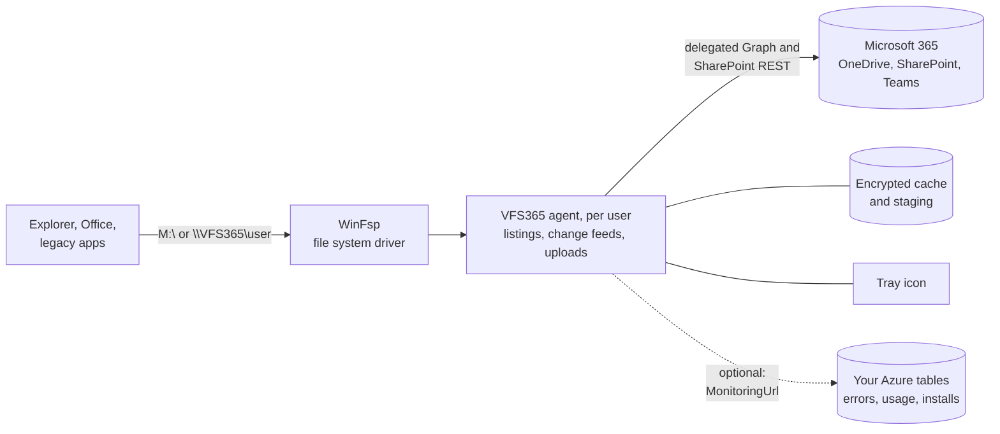
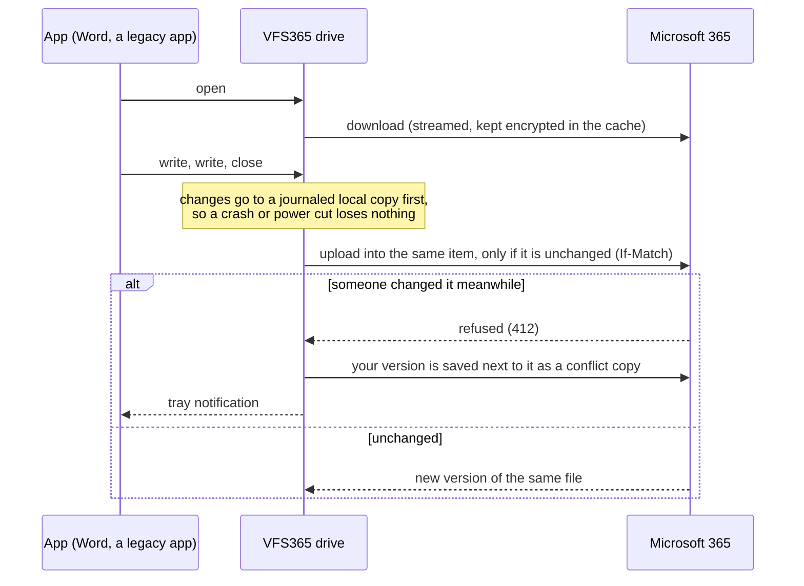
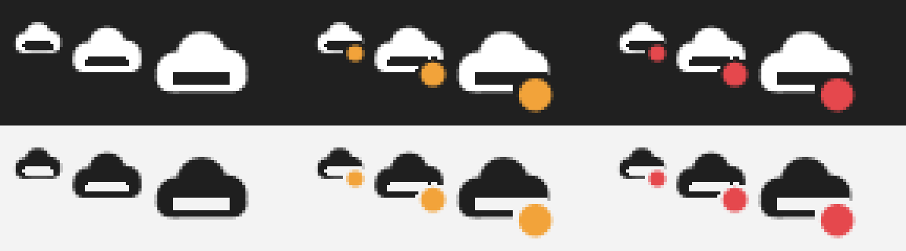
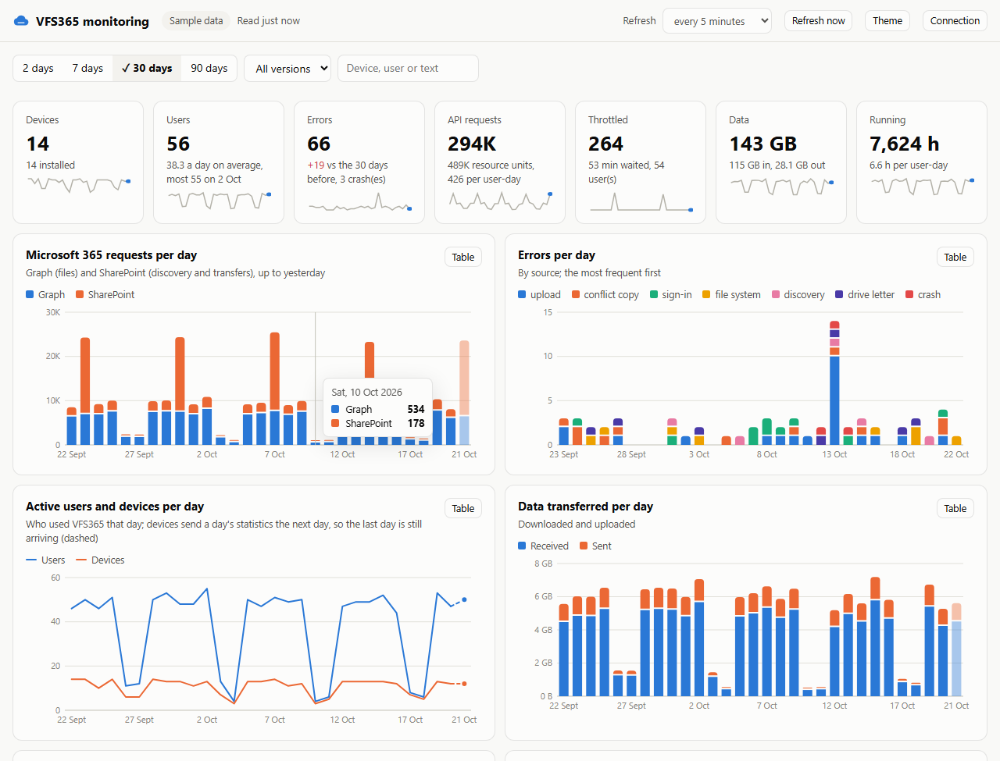

# VFS365

Shows Microsoft 365 (OneDrive, Teams and SharePoint libraries) as a drive and as an entry in Explorer's navigation pane, browsable with the signed-in user's own permissions and usable by legacy apps through ordinary file paths: open, save, delete, rename. No per-library setup, no sync.

Install: [Deployment](docs/DEPLOYMENT.md) Downloads: [Releases](../../releases). What changed: [CHANGELOG.md](CHANGELOG.md).

https://github.com/user-attachments/assets/a4b3872f-d3fd-4372-a001-83f90e983e33

## What users see

One location in Explorer, named by policy (default "VFS365"), with every library the user can reach. Apps use plain paths such as `M:\Sites\Finance\Documents\Budget.xlsx` or `\\VFS365\<user>\Sites\Finance\Documents\Budget.xlsx`.

```
VFS365 (navigation pane), \\VFS365\<user>, optionally a drive letter
├── OneDrive                  with Scope = All (the default) or OneDrive
├── Shared with me            with Scope = All: files and folders others shared with you
└── Sites                     with Scope = All; with SharePoint these are the root
    ├── Finance
    │   ├── Documents
    │   └── Contracts
    ├── Marketing
    └── Project X (Teams)
        └── Documents
```

Libraries appear when the user gets access and disappear when it ends; nothing is configured per library or per user.



## How it works

- A WinFsp network volume per user: `\\VFS365\<user>` and a navigation pane entry, optionally a drive letter. Works on multi-session hosts (AVD). Name, letter, content (SharePoint sites, OneDrive or both) and site filters are set by policy, as are Windows' user folders moved into it (Desktop, Documents, ...) and drive letters of their own for libraries or folders (`Z:` for Finance), with environment variables and wildcards in their paths ([how](docs/DEPLOYMENT.md#folder-redirection-and-drive-letters)).
- Signs in through Windows' own Web Account Manager (silently on Entra joined or registered devices) with JSolve's multi-tenant app: an admin consents once per tenant, no app registration needed. Forks and tenants that require their own registration set `ClientId`. Member accounts in their own tenant only (no guest access).
- Reports errors and daily usage to your own Azure table storage when `MonitoringUrl` is set, with a [dashboard](monitoring/vfs365-monitoring.html) to view them; API use per user is capped by policy.
- Libraries are discovered per user with SharePoint Search (M365AutoLink's method) and listed when opened; nothing is mirrored up front, so library size doesn't matter.
- Reads stream; saves upload into the existing item, keeping version history and sharing links; large copies upload while they are written. Copies of many small files run at disk speed: new files upload right after they are closed, four at a time, and copies out of the drive download the next small files ahead.
- Starts from the last session's libraries and folders, so the drive is there at logon; a change feed per library in use (delta plus push) brings in changes made elsewhere. Big folders show what has arrived while the rest loads.
- File copies are cached encrypted per user, size-limited, and wiped by `vfs365 signout`, on an account change or at Intune unenrollment. A tray icon (English or Dutch) reports conflicts, waiting uploads with their cause, and sign-in problems, and offers Sign in; with the icon, the drive never asks for a sign-in by itself once it runs.

### Saving a file

Saves go into the existing item, so version history, sharing links and metadata stay. Nothing is ever overwritten silently:



### Starting and keeping up


Idle drives make no calls. Discovery and change checks yield to what users open and save, and back off when Microsoft throttles; see [API use](docs/DEPLOYMENT.md#api-use).

### Explorer menu

Right-click a file or folder in the drive (on Windows 11 under "Show more options"), then VFS365: Open in browser, Open in desktop app (Word, Excel, PowerPoint, co-authoring included), Copy link (for people who already have access; no sharing link is made), Version history, and Share in browser (opens the item in the browser, where its Share button is). On a conflict copy also Keep this version (the copy becomes a new version of the original; the other version stays in its version history) and Compare with the original.

### Tray

The tray icon follows the taskbar theme and shows whether everything is saved (plain), something is waiting to upload (amber) or needs attention (red). Its menu has Show files, Show log, Collect diagnostics (one zip for the helpdesk, tokens removed), Restart, Sign in when needed, and Help (your own service desk page by policy). English or Dutch, by the Windows display language.



### Monitoring

With the `MonitoringUrl` policy, every device reports errors, daily usage and installs to your own Azure table storage. The [dashboard](monitoring/vfs365-monitoring.html) is one HTML file that reads those tables with a read-only SAS and shows what needs attention, trends, per-device and per-user details, and the headroom left under Microsoft's per-app limits for the next rollout wave:



#### Setting up monitoring

You need an Azure storage account with three tables and two shared access signatures (SAS): one that devices use to add rows and can't read anything, and one that the dashboard uses to read and can't change anything.

**Quickest: deploy it to Azure.**

[](https://portal.azure.com/#create/Microsoft.Template/uri/https%3A%2F%2Fraw.githubusercontent.com%2Fjflieben%2FVFS365%2Fmain%2Fmonitoring%2Fazuredeploy.json)

The [template](monitoring/azuredeploy.json) creates, in a resource group you choose:
- a storage account (StorageV2, TLS 1.2, no public blob access) with the tables `errors`, `statistics` and `devices`;
- the dashboard on the account's static website (`https://<account>.z<n>.web.core.windows.net/`, the latest release's page), with CORS that lets only that address read the tables;
- four outputs (resource group > Deployments > the deployment > Outputs): `monitoringUrl`, the policy value for the devices (add only, two years); `dashboardUrl`, the dashboard's address; `dashboardLink`, the dashboard connected with a read-only SAS (30 days); and `dashboardSasUrl`, that read-only SAS URL on its own, to paste into the dashboard.

Then set the policy (step 3 below). To renew both SAS URLs and update the dashboard page, use the Deploy to Azure button again with the same resource group: the account keeps its name and its rows. Not the portal's Redeploy on the old deployment: it reuses that deployment's start time, so the SAS URLs would keep their old expiry dates and the page upload would fail.

The outputs stay in the resource group's deployment history, where anyone who can read the group sees them; `dashboardSasDays` = 0 leaves the dashboard link out. Hosting the dashboard runs a short deployment script on Azure Container Instances; where a policy blocks that, set `hostDashboard` to false, open the page from disk and add `*` to `extraCorsOrigins`.

**By hand**, or with the Azure CLI below:

1. **Storage account.** Any StorageV2 account works; Standard LRS is plenty. Create the tables `errors`, `statistics` and `devices` (portal: Storage browser > Tables > Add table).
2. **SAS for the devices.** Storage account > Security + networking > Shared access signature: allowed services **Table**, resource types **Object**, permissions **Add** only, HTTPS only, an expiry date (one or two years, with a reminder to renew). Generate and copy the **Table service SAS URL** (`https://<account>.table.core.windows.net/?sv=...&sp=a&...`).
3. **Policy.** Set **Report to Azure table storage** (`MonitoringUrl`) to that URL as a **computer** policy: Group Policy (Computer Configuration > Administrative Templates > JSolve > VFS365 > Monitoring) or the Intune settings catalog after importing the ADMX. It is the registry value `MonitoringUrl` (REG_SZ) under `HKLM\SOFTWARE\Policies\JSolve\VFS365`. Computer policy, so the installer can report installs and updates too. Optional: **Detail in error reports** (`MonitoringDetail`) = `NoPaths` keeps file and folder paths out of the reports.
4. **SAS for the dashboard.** A second SAS: services **Table**, resource type **Object**, permission **Read**, HTTPS only, a short expiry (the dashboard warns three days before it ends). The dashboard only reads rows, so it needs nothing more.
5. **CORS**, so a browser may read the tables: Settings > Resource sharing (CORS) > Table service: allowed origins `*` (a page opened from disk needs `*`; or the https address where you host the dashboard), methods `GET` and `OPTIONS`, allowed and exposed headers `*`, max age `3600`.
6. **Open the dashboard** ([vfs365-monitoring.html](monitoring/vfs365-monitoring.html), also attached to every release) in a browser and paste the second SAS URL. Rows appear as devices report: errors at once, a day's statistics the next day. Opened from disk, "Remember" keeps the SAS for that tab only; host the page on https to remember it.

The same with the Azure CLI, in PowerShell:

```powershell
$account = "contosovfs365"; $group = "rg-vfs365"; $location = "westeurope"   # account names: 3-24 lower-case letters and digits
az group create --name $group --location $location
az storage account create --name $account --resource-group $group --location $location --sku Standard_LRS --kind StorageV2 --min-tls-version TLS1_2 --allow-blob-public-access false
$key = az storage account keys list --account-name $account --resource-group $group --query "[0].value" -o tsv
foreach ($table in "errors", "statistics", "devices") { az storage table create --name $table --account-name $account --account-key $key }

# Devices: add only, two years
$add = az storage account generate-sas --account-name $account --account-key $key --services t --resource-types o --permissions a --https-only --expiry (Get-Date).AddYears(2).ToString("yyyy-MM-dd") -o tsv
"MonitoringUrl: https://$account.table.core.windows.net/?$add"

# Dashboard: read only, 30 days
$read = az storage account generate-sas --account-name $account --account-key $key --services t --resource-types o --permissions r --https-only --expiry (Get-Date).AddDays(30).ToString("yyyy-MM-dd") -o tsv
"Dashboard: https://$account.table.core.windows.net/?$read"

az storage cors add --account-name $account --account-key $key --services t --methods GET OPTIONS --origins "*" --allowed-headers "*" --exposed-headers "*" --max-age 3600
```

Good to know:

- **Renewing and revoking.** An expired devices SAS sends nothing (each device logs that once); set the new URL in the policy before the old one ends. A SAS can't be revoked on its own: regenerating the storage key it was signed with (`key1` above) revokes every SAS signed with that key. Sign new ones with `key2` first, roll them out, then regenerate `key1`.
- **Network.** Devices send over https straight to `<account>.table.core.windows.net`. With the storage firewall on, allow your offices, VPN and AVD subnets, or the reports don't arrive (the log says why).
- **Privacy.** Rows contain user and device names, and error rows file and folder paths unless `MonitoringDetail` is `NoPaths`. Keep the dashboard SAS short-lived and only share it with whoever needs it; anyone with it can read every row. Rows are not signed: anyone with the devices SAS can add rows.
- **Cost.** Small: a statistics row per user per day and a few error rows. For 2,500 users that is about 2,500 rows and a few MB a day, which costs cents a month in a standard account.

See [Monitoring in DEPLOYMENT.md](docs/DEPLOYMENT.md#monitoring) for every column and when it is sent.

## Limitations

- Discovery uses SharePoint Search: sites excluded from search and Restricted Content Discovery sites aren't found. Pinned locations (policy, or `vfs365 pin` per user) fill the gap.
- Byte-range locks don't cross machines: multi-user Access, QuickBooks and SQLite files are unsafe. The `DatabaseFiles` policy makes them read-only or blocks them if you want / expect concurrent use
- No Office co-authoring from the drive; that works only through Microsoft's own client. Right-click a Word, Excel or PowerPoint file, VFS365, Open in desktop app to open it from Microsoft 365 instead, where co-authoring works.
- While a user's drive isn't running, `\\VFS365` is an ordinary server name to Windows. Turn off LLMNR and NetBIOS name resolution and own the DNS name, as in [The name VFS365 on the network](docs/DEPLOYMENT.md#the-name-vfs365-on-the-network).
- x64 apps on ARM64 devices can't resolve typed `\\VFS365` paths in their file dialogs (files open and save normally); see [Known limitations](docs/DEPLOYMENT.md#known-limitations).

## Docs

- [Deployment](docs/DEPLOYMENT.md) (install, policies, antivirus, monitoring) and [app registration](docs/APP-REGISTRATION.md)
- [Architecture](docs/ARCHITECTURE.md) and [changelog](CHANGELOG.md)
- [Contributing](CONTRIBUTING.md), [support](SUPPORT.md) and [security](SECURITY.md)

## Support

VFS365 is free software; support is not free. Bugs and ideas are welcome as [issues](../../issues). For help with deployment, troubleshooting or changes for your organisation, see [SUPPORT.md](SUPPORT.md) or https://jsolve.nl.

## If you want to build your own

Needs the .NET 10 SDK (`build.ps1` finds a portable one too). Running the drive needs WinFsp. Releases also compile the small C network provider with Zig, which `build.ps1` fetches (pinned, hash-checked).

- `./build.ps1 test`: build and run the tests.
- `./build.ps1 run <command>`: run the console tool (`settings`, `whoami`, `discover`, `mount`, `unmount`, `pin`, `machine-stop`, `about`).
- `./build.ps1 release`: setup programs (with WinFsp) and MSIs for x64 and ARM64 of the version in `VERSION`, in `release/<version>/` ([release/README.md](release/README.md)). `./build.ps1 bump` raises the patch number.
- Releases on GitHub are built by GitHub Actions when `VERSION` changes on `main` ([.github/workflows/release.yml](.github/workflows/release.yml)).

## Licence

Copyright (C) JSolve B.V. VFS365 is free software under the GNU General Public License version 3 ([LICENSE](LICENSE)).

Uses WinFsp - Windows File System Proxy, Copyright (C) Bill Zissimopoulos, https://github.com/winfsp/winfsp. Other components: [THIRD-PARTY-NOTICES.md](THIRD-PARTY-NOTICES.md).
