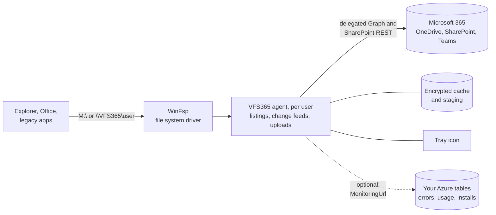
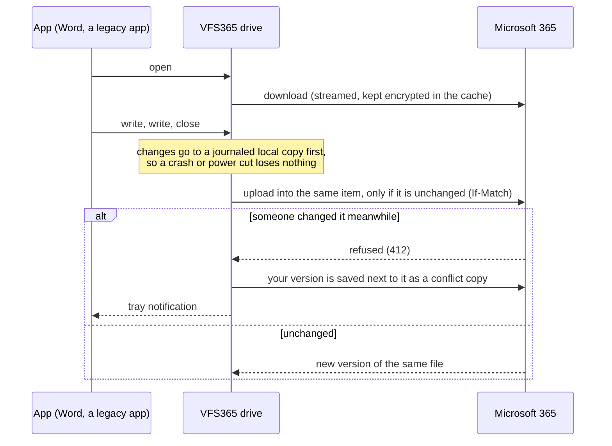
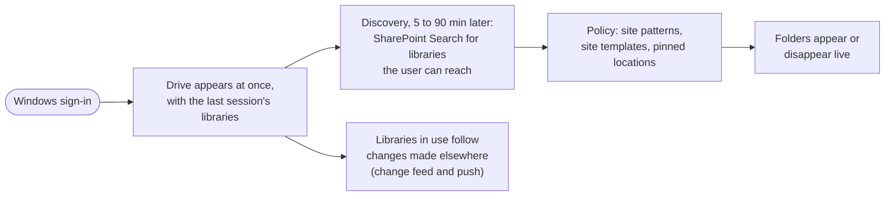

# VFS365

Shows Microsoft 365 (OneDrive, Teams and SharePoint libraries) as a drive and as an entry in Explorer's navigation pane, browsable with the signed-in user's own permissions and usable by legacy apps through ordinary file paths: open, save, delete, rename. No per-library setup, no sync.

Status: early releases, in use at the first organisations. Downloads: [Releases](../../releases). What changed: [CHANGELOG.md](CHANGELOG.md).

## What users see

One location in Explorer, named by policy (default "VFS365"), with every library the user can reach. Apps use plain paths such as `M:\Finance\Documents\Budget.xlsx` or `\\VFS365\<user>\Finance\Documents\Budget.xlsx`.

```
VFS365 (navigation pane), \\VFS365\<user>, optionally a drive letter
├── OneDrive                  with Scope = All or OneDrive
└── Sites                     with Scope = All; with SharePoint (the default) these are the root
    ├── Finance
    │   ├── Documents
    │   └── Contracts
    ├── Marketing
    └── Project X (Teams)
        └── Documents
```

Libraries appear when the user gets access and disappear when it ends; nothing is configured per library or per user.



## How it works

- A WinFsp network volume per user: `\\VFS365\<user>` and a navigation pane entry, optionally a drive letter. Works on multi-session hosts (AVD). Name, letter, content (SharePoint sites, OneDrive or both) and site filters are set by policy.
- Signs in with JSolve's multi-tenant app: an admin consents once per tenant, no app registration needed. Forks and tenants that require their own registration set `ClientId`. Member accounts in their own tenant only (no guest access).
- Reports errors and daily usage to your own Azure table storage when `MonitoringUrl` is set, with a [dashboard](monitoring/vfs365-monitoring.html) to view them; API use per user is capped by policy.
- Libraries are discovered per user with SharePoint Search (M365AutoLink's method) and listed when opened; nothing is mirrored up front, so library size doesn't matter.
- Reads stream; saves upload into the existing item, keeping version history and sharing links; large copies upload while they are written. Copies of many small files run at disk speed: new files upload right after they are closed, four at a time, and copies out of the drive download the next small files ahead.
- Starts from the last session's libraries and folders, so the drive is there at logon; a change feed per library in use (delta plus push) brings in changes made elsewhere. Big folders show what has arrived while the rest loads.
- File copies are cached encrypted per user, size-limited, and wiped by `vfs365 signout`, on an account change or at Intune unenrollment. A tray icon (English or Dutch) reports conflicts, waiting uploads with their cause, and sign-in problems, and offers Sign in; the drive never asks for a sign-in by itself once it runs.

### Saving a file

Saves go into the existing item, so version history, sharing links and metadata stay. Nothing is ever overwritten silently:



### Starting and keeping up



Idle drives make no calls. Discovery and change checks yield to what users open and save, and back off when Microsoft throttles; see [API use](docs/DEPLOYMENT.md#api-use).

### Tray

The tray icon follows the taskbar theme and shows whether everything is saved (plain), something is waiting to upload (amber) or needs attention (red). Its menu has Show files, Show log, Refresh, Restart, Sign in when needed, and Help (your own service desk page by policy). English or Dutch, by the Windows display language.


### Monitoring

With the `MonitoringUrl` policy, every device reports errors, daily usage and installs to your own Azure table storage. The [dashboard](monitoring/vfs365-monitoring.html) is one HTML file that reads those tables with a read-only SAS and shows what needs attention, trends and per-device and per-user details:


## Limits no design removes

- Discovery uses SharePoint Search: sites excluded from search and Restricted Content Discovery sites aren't found. Pinned locations (policy, or `vfs365 pin` per user) fill the gap.
- Byte-range locks don't cross machines: multi-user Access, QuickBooks and SQLite files are unsafe. The `DatabaseFiles` policy makes them read-only or blocks them.
- No Office co-authoring from the drive; that works only through Microsoft's own client.

## Docs

- [Deployment](docs/DEPLOYMENT.md) (install, policies, antivirus, monitoring) and [app registration](docs/APP-REGISTRATION.md)
- [Architecture](docs/ARCHITECTURE.md) and [changelog](CHANGELOG.md)
- [Contributing](CONTRIBUTING.md), [support](SUPPORT.md) and [security](SECURITY.md)

## Support

VFS365 is free software; support is not free. Bugs and ideas are welcome as [issues](../../issues). For help with deployment, troubleshooting or changes for your organisation, see [SUPPORT.md](SUPPORT.md) or https://jsolve.nl.

## Build

Needs the .NET 10 SDK (`build.ps1` finds a portable one too). Running the drive needs WinFsp. Releases also compile the small C network provider with Zig, which `build.ps1` fetches (pinned, hash-checked).

- `./build.ps1 test`: build and run the tests.
- `./build.ps1 run <command>`: run the console tool (`settings`, `whoami`, `discover`, `mount`, `unmount`, `pin`, `machine-stop`, `about`).
- `./build.ps1 release`: setup programs (with WinFsp) and MSIs for x64 and ARM64 of the version in `VERSION`, in `release/<version>/` ([release/README.md](release/README.md)). `./build.ps1 bump` raises the patch number.
- Releases on GitHub are built by GitHub Actions when `VERSION` changes on `main` ([.github/workflows/release.yml](.github/workflows/release.yml)).

## Licence

Copyright (C) JSolve B.V. VFS365 is free software under the GNU General Public License version 3 ([LICENSE](LICENSE)).

Uses WinFsp - Windows File System Proxy, Copyright (C) Bill Zissimopoulos, https://github.com/winfsp/winfsp. Other components: [THIRD-PARTY-NOTICES.md](THIRD-PARTY-NOTICES.md).
